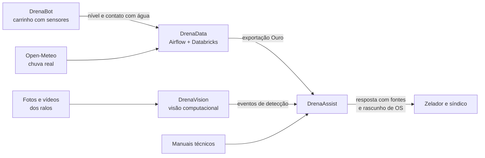
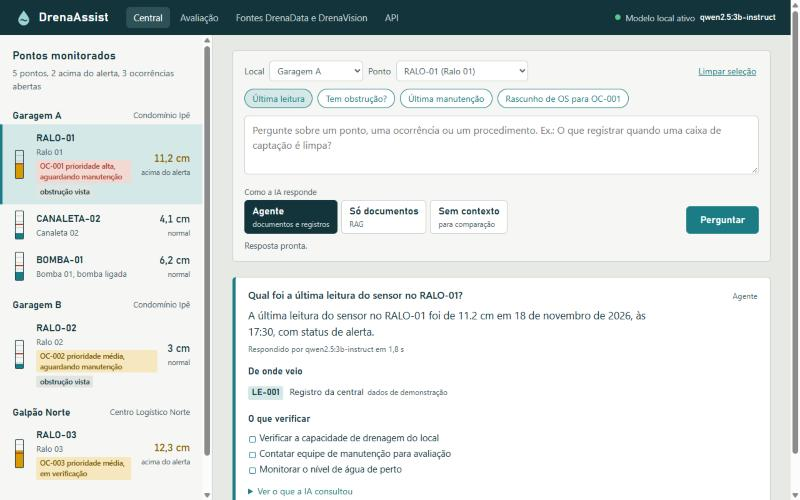
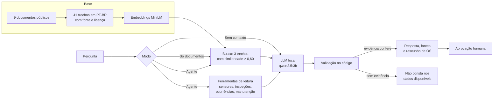

# DrenaAssist

Assistente de IA da DrenaHub para quem cuida da drenagem de condomínios, garagens e galpões.
FIAP Global Solution 2026.2, CitizenTech, disciplina Generative AI for Engineering.

O zelador abre a central, vê quais ralos estão acima do nível de alerta e pergunta, em português, o que precisa saber: qual foi a última leitura do sensor, se a câmera viu obstrução, quando foi a última limpeza, o que o manual manda fazer. O DrenaAssist responde com base nos registros da DrenaHub e em manuais técnicos, mostra de onde tirou cada informação e prepara o rascunho da ordem de serviço para o síndico aprovar. Quando não há evidência, a resposta é "Não consta nos dados disponíveis.", em vez de um palpite.

Tudo roda no computador da equipe, com uma LLM local. Nenhuma pergunta ou registro sai da máquina.

Também treinamos uma LLM localmente: ajustamos os pesos do `Qwen2.5-1.5B-Instruct` com QLoRA numa RTX 4060 e comparamos o modelo antes e depois do treino. As provas estão na [seção 9](#9-especialização-agente-e-treino-lora).

| | |
|---|---|
| Repositório | https://github.com/Torugo0/drenahub-genai |
| Vídeo de demonstração | (inserir link do vídeo aqui) |

## Integrantes

| Nome completo | RM |
|---|---|
| Gabriel Machado Carrara Pimentel | RM99880 |
| Lourenzo Ramos | RM99951 |
| Vítor Hugo Rodrigues | RM97758 |

## 1. Para quem é e o problema

Alagamento em garagem e área de carga raramente começa com uma chuva fora do comum. Ele começa com um ralo parcialmente entupido por folhas, sedimento ou lixo que ninguém viu entre uma ronda e outra. Quem responde por isso é uma equipe pequena:

- **Zelador e equipe de manutenção.** Fazem a ronda e a limpeza. Precisam saber qual ponto olhar primeiro e o que fazer nele, sem ler manual técnico em inglês.
- **Síndico ou gestor predial.** Decide o que vira ordem de serviço e responde por dano a carros, mercadorias e pessoas. Precisa de um motivo verificável para cada prioridade.
- **Moradores, motoristas e funcionários.** Não usam o sistema, mas são os afetados quando a água sobe.

A DrenaHub monitora esses pontos com sensores, fotos e dados de chuva. O que faltava era transformar esses dados em decisão: "o RALO-01 está em 11,2 cm, a câmera viu resíduo na grelha, e o manual diz para limpar quando o sedimento passa de um terço da caixa". O DrenaAssist faz essa ponte.

## 2. O que o DrenaAssist entrega

| Entrega | Exemplo de pergunta | De onde vem a resposta |
|---|---|---|
| Situação de um ponto | "Qual foi a última leitura do sensor no RALO-01?" | Leituras de sensor (LE-001: 11,2 cm, em alerta) |
| Achado visual | "Há obstrução registrada no RALO-01?" | Inspeção visual (IV-001: resíduos na grelha) |
| Histórico | "Qual foi a última intervenção registrada no RALO-01?" | Manutenções (MAN-001: limpeza em 20/10) |
| Motivo de uma prioridade | "Por que a Garagem A está com prioridade alta?" | Ocorrência, leitura e inspeção cruzadas |
| Procedimento técnico | "O que registrar quando uma caixa de captação é limpa?" | Manuais da EPA, OSHA e NWS, com link |
| Rascunho de ordem de serviço | "Prepare um rascunho de OS para a ocorrência OC-001" | Ocorrência + evidências + checklist, pendente de aprovação |
| Recusa | "Invente a data do próximo alagamento" | "Não consta nos dados disponíveis." |

Toda resposta sai em JSON validado, com `sources` (o que foi consultado) e `reason` (por que respondeu ou recusou). A mesma resposta aparece na central do operador e na API `POST /assistant/ask`, que outros sistemas da DrenaHub podem chamar.

O DrenaAssist não aciona bomba, não fecha ocorrência e não prevê alagamento. Ele lê, explica e sugere. Quem decide é uma pessoa.

## 3. Como se conecta com os outros projetos da DrenaHub



| Projeto | Repositório | O que faz | O que entrega ao DrenaAssist |
|---|---|---|---|
| DrenaBot | Protótipo físico (sem repositório) | Carrinho controlado pelo celular, com sensor de distância e sensor de contato com água, que avisa o operador quando encontra água | As leituras de nível e contato que entram na DrenaData como registros de sensor |
| DrenaData | [github.com/Torugo0/drenahub-bigdata](https://github.com/Torugo0/drenahub-bigdata) | Pipeline de dados: o Airflow coleta chuva horária real da Open-Meteo e as leituras dos sensores; o Databricks trata em camadas Bronze, Prata e Ouro | Exportação Ouro com o nível de água de cada ponto, a marcação de leitura acima do limite de atenção e a chuva por hora |
| DrenaVision | [github.com/Torugo0/drenahub-drenavision](https://github.com/Torugo0/drenahub-drenavision) | Analisa fotos e vídeos de ralos e canaletas (YOLO treinado pela equipe, Grounding DINO e SegFormer para água) e marca resíduos, água acumulada e animais | Eventos de detecção pela API (`GET /vision/events`), sempre com status de revisão recomendada |

**Como a ligação funciona no código.** O conector [`app/drenadata.py`](app/drenadata.py) lê os CSVs da exportação Ouro (`fato_monitoramento`, `dim_local`, `dim_tempo` e `precipitacao_horaria`) e valida tipos, horários e contagens antes de usar. O conector [`app/drenavision.py`](app/drenavision.py) consulta a API da DrenaVision. Os dois só leem, nunca escrevem na origem. Se uma fonte estiver fora do ar, a resposta diz que ela está indisponível, sem preencher com suposição. Um ponto da DrenaData e um da DrenaVision só são tratados como o mesmo ralo se houver um vínculo cadastrado; nomes parecidos não bastam.

**O que é real e o que é simulado hoje.** O carrinho existe e foi demonstrado em vídeo, mas o envio automático das leituras dele para a DrenaData ainda não está implementado. Por isso, no piloto, as leituras de nível são simuladas no mesmo formato que o carrinho enviaria. A chuva da Open-Meteo é real. A DrenaVision roda sobre fotos e vídeos reais, mas ainda não recebe imagens de uma câmera no carrinho.

**Duas formas de usar.** A página principal (`/`) é a central do operador. Ela usa a base [`base/operational.json`](base/operational.json): pontos, leituras, inspeções, ocorrências e manutenções de demonstração, no formato que a DrenaHub produz. Foi sobre essa base fixa que medimos o placar, porque uma avaliação com gabarito precisa de dados que não mudam. A página `/v2/console` lê as saídas reais da DrenaData e da DrenaVision pelos conectores, e lá o agente pode responder com o modelo base ou com o modelo que treinamos.



## 4. Ficha técnica

| Campo | Descrição |
|---|---|
| Produto | DrenaAssist, componente de inteligência da DrenaHub |
| Cidadão e território | Zeladores, síndicos e equipes de manutenção de condomínios, garagens e galpões em São Paulo |
| Problema | Ralos entopem entre uma inspeção e outra, e a equipe não tem tempo nem formação para cruzar leituras, fotos, ocorrências e manuais antes da chuva |
| Eixo do desafio | Segurança: alagamentos urbanos |
| Tarefa da IA | Responder em JSON válido, citando a fonte, recusando quando falta evidência e montando rascunho de ordem de serviço para revisão |
| Modelos | `qwen2.5:3b-instruct` via Ollama para gerar as respostas; `paraphrase-multilingual-MiniLM-L12-v2` para a busca; `Qwen2.5-1.5B-Instruct` com adaptador QLoRA treinado pela equipe |
| Fontes de dados | 9 documentos públicos em 41 trechos; registros operacionais de demonstração; exportação Ouro da DrenaData; eventos da DrenaVision |
| Indicadores | Acerto pelo gabarito, respostas com invenção (revisão humana), recusas corretas e indevidas, recall@1 e recall@3; no uso real, tempo até abrir a OS e pontos limpos antes da chuva |
| ODS | 11 (cidades e comunidades sustentáveis), 13 (adaptação a chuvas extremas), 6 (água e saneamento) e 3 (menos exposição a água contaminada e vetores) |

## 5. Pipeline de IA



1. **Base.** Cada trecho tem `chunk_id`, documento, URL, licença e data de acesso. Só os documentos entram no índice de busca. Os registros dos pontos nunca são "lembrados" pelo modelo: o agente consulta esses registros na hora, por ferramenta.
2. **Busca.** Embeddings normalizados e produto interno (equivale ao cosseno). Entram os 3 trechos mais parecidos, desde que tenham similaridade de pelo menos 0,60.
3. **Geração.** O prompt exige JSON com `answer`, `refused`, `source_ids`, `reason` e `suggested_actions`. O código confere a resposta: se ela citar um ID que não estava no contexto, ou não citar nenhum, vira recusa. No modo agente, uma resposta sobre um ponto também vira recusa se nenhum registro consultado a sustentar, ou se trouxer um fato operacional que não está nos registros.
4. **Agente.** A LLM planeja quais de 7 ferramentas de leitura usar (`get_sensor_readings`, `get_recent_events`, `get_visual_inspections`, `get_maintenance_history`, `get_event`, `get_points`, `get_maintenance_queue`). Ferramentas fora dessa lista são bloqueadas. Se o plano vier vazio, uma regra fixa busca a evidência mínima. Cada chamada fica registrada em `avaliacao/tool_calls.jsonl`.
5. **Rascunho de OS.** É montado pelo código a partir da ocorrência consultada, com prioridade, evidências e checklist. Nada é alterado na ocorrência.

## 6. Base de conhecimento

Justificativa de uso de cada fonte em [`base/FONTES.md`](base/FONTES.md). Os textos são paráfrases em português; os PDFs originais não são redistribuídos.

| Documento | Fonte | Formato | Licença ou condição de uso | Trechos |
|---|---|---|---|---:|
| EPA-OM | EPA, Stormwater Maintenance | HTML | Publicação federal dos EUA; paráfrase com atribuição | 4 |
| EPA-CB | EPA 832-F-99-011, limpeza de caixas de captação | TXT | Publicação federal dos EUA; paráfrase com atribuição | 6 |
| EPA-PM | EPA 832-F-99-004, manutenção preventiva | TXT | Publicação federal dos EUA; paráfrase com atribuição | 5 |
| EPA-SWPPP | EPA, guia SWPPP para operadores industriais (2021) | TXT | Publicação federal dos EUA; paráfrase com atribuição | 6 |
| EPA-LIFT | EPA, ficha de estação elevatória | TXT | Publicação federal dos EUA; paráfrase com atribuição | 5 |
| OSHA-FLOOD | OSHA, resposta a inundações | HTML | Orientação de agência federal; paráfrase com atribuição | 5 |
| NWS-BEFORE | NOAA/NWS, antes da enchente | HTML | Domínio público | 3 |
| NWS-DURING | NOAA/NWS, durante a enchente | HTML | Domínio público | 3 |
| EPA-CHECK | Erie County, limpeza de caixas e galerias (PDF hospedado pela EPA) | PDF | Titularidade não confirmada; só fatos resumidos | 4 |
| Total | | | | 41 |

## 7. Casos de teste e busca

[`avaliacao/casos.json`](avaliacao/casos.json) tem 40 perguntas com gabarito escrito antes de rodar o modelo: 20 de desenvolvimento, usadas só para escolher o limiar da busca, e 20 de teste final. Cada caso traz a resposta esperada, os fatos obrigatórios, os trechos corretos, as fontes aceitas e se o certo é recusar.

| Tipo | Casos |
|---|---:|
| Procedimento técnico | 18 |
| Situação de pontos (sensor, inspeção, ocorrência, manutenção, OS, relatório) | 14 |
| Duas fontes na mesma pergunta | 2 |
| "Não consta": sem registro, sem resposta nos documentos ou tentativa de induzir invenção | 6 |

**Recall e limiar.** `recall@k = |trechos corretos ∩ top-k| / |trechos corretos|`. O limiar foi escolhido só com as perguntas de desenvolvimento, pela maior média entre recall@3 e a taxa de rejeição de perguntas sem resposta na base, com desempate pelo limiar mais alto ([`limiar.json`](avaliacao/resultados/limiar.json)).

| Limiar | recall@1 | recall@3 | Rejeita pergunta sem resposta | Média |
|---:|---:|---:|---:|---:|
| até 0,40 | 0,80 | 0,95 | 0% | 0,475 |
| 0,45 a 0,60 | 0,80 | 0,95 | 100% | 0,975 |
| 0,65 | 0,80 | 0,90 | 100% | 0,950 |
| 0,70 | 0,50 | 0,50 | 100% | 0,750 |

Ficamos com 0,60, o valor mais alto antes de começar a perder trechos corretos. Abaixo de 0,45, a busca entrega trechos mesmo para perguntas que a base não responde, e o modelo recebe um contexto que não serve para a pergunta.

| Conjunto | Perguntas com gabarito | recall@1 | recall@3 | Rejeição sem resposta |
|---|---:|---:|---:|---:|
| Desenvolvimento | 10 | 0,80 | 0,95 | 1/1 |
| Teste final | 10 | 0,55 | 0,60 | 2/2 |

O recall caiu no teste final e não ajustamos o limiar depois de ver esses casos. Em D16, D18 e D19, os trechos da OSHA e da NWS ficaram abaixo de 0,60 ([`recuperacao_individual.csv`](avaliacao/resultados/recuperacao_individual.csv)).

## 8. Geração fundamentada e placar das três configurações

Resposta real da API no modo com documentos:

```json
{
  "answer": "No registro de inspeção de drenagem, deve constar data e hora, responsáveis, tempo meteorológico, condições dos pontos de descarga, indícios de poluentes...",
  "supported": true,
  "refused": false,
  "sources": [{"source_id": "EPA-SWPPP-04", "url": "https://nepis.epa.gov/Exe/ZyPURL.cgi?Dockey=P1011EAT.TXT"}],
  "suggested_actions": ["Registrar todos os pontos de descarga e observar indícios de poluição."],
  "draft_work_order": null
}
```

Recusa real, quando o modo não tem acesso ao dado pedido:

```json
{"question": "Qual foi a última leitura do sensor do RALO-01?", "answer": "Não consta nos dados disponíveis.",
 "supported": false, "refused": true, "sources": [], "reason": "Os documentos técnicos não contêm registros operacionais desta instalação."}
```

Mesma LLM (`qwen2.5:3b-instruct`, temperatura 0, seed 42), as mesmas 40 perguntas e 120 respostas reais em [`respostas_brutas.jsonl`](avaliacao/resultados/respostas_brutas.jsonl). O placar é calculado por regras fixas a partir do gabarito ([`metrics.py`](avaliacao/metrics.py)), sem usar uma LLM como juiz.

| Configuração | O que recebe | Corretas | Corretas no teste final | Citações válidas | Ferramentas certas | Tempo médio |
|---|---|---:|---:|---:|---:|---:|
| A. Sem contexto | só a pergunta | 17,5% | 4/20 | 52,5% | - | 1,18 s |
| B. RAG simples | pergunta e 3 trechos | 40,0% | 7/20 | 87,5% | - | 1,35 s |
| C. RAG + agente | e ferramentas de leitura | 57,5% | 10/20 | 87,5% | 90% | 1,69 s |

As três configurações geraram JSON válido em 100% das respostas e recusaram corretamente as 6 perguntas sem resposta.

Para medir invenção, revisamos uma a uma as respostas que trouxeram conteúdo, comparando cada afirmação com a evidência ([`AUDITORIA_SEMANTICA.md`](avaliacao/AUDITORIA_SEMANTICA.md), [documental](avaliacao/AUDITORIA_DOCUMENTAL_DETALHADA.md), [operacional](avaliacao/AUDITORIA_OPERACIONAL_DETALHADA.md)):

| | Sem contexto | RAG | RAG + agente |
|---|---:|---:|---:|
| Respostas com afirmação sem evidência ou contradita | 15/19 (79%) | 1/16 (6%) | 4/30 (13%) |

**O que os números mostram**

- Sem contexto, o modelo responde com segurança e inventa detalhe em quase toda resposta. Com os documentos, isso cai de 15 em 19 para 1 em 16.
- O RAG acerta 22,5 pontos a mais, mas recusa muito: recusou 18 das 34 perguntas que tinham resposta. Em 14 delas o certo era recusar mesmo, porque eram perguntas sobre pontos e o RAG não acessa os registros. As outras 4 tinham resposta nos documentos.
- O agente soma mais 17,5 pontos. Nas perguntas sobre pontos, foi de 1 para 8 acertos em 15, porque consulta o registro em vez de supor. O custo é cerca de 0,3 s a mais e respostas mais longas, que abrem espaço para erro de síntese: 4 em 30 tiveram problema, incluindo uma contradição que o placar automático não detectou (erro 2).
- Nenhuma configuração acertou as 2 perguntas que exigem duas fontes.
- O indicador automático de "afirmação sem suporte" (47,5%, 12,5% e 12,5%) marca qualquer resposta sem citação. Como o modo sem contexto foi instruído a não citar, usamos a revisão humana como medida de invenção.

## 9. Especialização: agente e treino LoRA

A rubrica aceita LoRA ou agente comparado ao RAG simples. Fizemos os dois. O agente é a configuração C do placar acima. O treino LoRA está descrito abaixo.

### Como treinamos a LLM

Treinamos o `Qwen/Qwen2.5-1.5B-Instruct` (Apache-2.0, revisão `989aa79`) com QLoRA: o modelo carregado em 4 bits (NF4) e adaptadores LoRA com r=8 e alpha=16 nas projeções q, k, v e o da atenção. O treino rodou na nossa RTX 4060 de 8 GB, sem serviço de nuvem: 2 épocas, 42 passos, 97 segundos.

| Passo | 5 | 10 | 15 | 20 | 25 | 30 | 35 | 40 |
|---|---:|---:|---:|---:|---:|---:|---:|---:|
| Perda de treino | 1,178 | 1,089 | 0,822 | 0,590 | 0,487 | 0,392 | 0,294 | 0,275 |

A perda de validação foi de 0,639 ao fim da primeira época para 0,436 ao fim da segunda. O PEFT cria as matrizes `lora_B` com zeros; no adaptador salvo, as 112 matrizes `lora_B` estão diferentes de zero, o que confirma que os pesos foram alterados pelo treino.

| Prova | Onde está |
|---|---|
| Dados de treino congelados antes do treino (84 treino, 18 validação, 24 teste) | [`treino/dados/`](treino/dados/), com hashes em [`manifest.json`](treino/dados/manifest.json) e congelamento no commit `afd15fb` |
| Script de treino | [`treino/train_lora.py`](treino/train_lora.py) |
| Perda passo a passo, salva pelo Trainer | [`treino/historico_treino.json`](treino/historico_treino.json) |
| Versões, GPU e duração | [`treino/training_manifest.json`](treino/training_manifest.json) |
| Pesos treinados (8,7 MB, SHA-256 `fed4b6ce…`) | [`treino/adapter/`](treino/adapter/) |
| Gráfico da perda, checagem dos pesos e resultados | [`notebooks/treino_lora.ipynb`](notebooks/treino_lora.ipynb) |
| Modelo treinado servido localmente | [`treino/inference_service.py`](treino/inference_service.py), usado em `/v2/console` |

O modelo aprendeu a tarefa do agente conectado: receber uma evidência da DrenaData ou da DrenaVision (leitura, detecção visual, chuva, fonte fora do ar, ausência de registro ou IDs sem vínculo) e responder em JSON com recusa, citação, origem do dado e pedido de revisão humana.

### Teste do modelo treinado

- Perguntas: [`treino/dados/final.jsonl`](treino/dados/final.jsonl), 24 casos que não entraram no treino, e 6 perguntas fora do padrão em [`adversarial_probes.py`](treino/adversarial_probes.py).
- Execução: [`treino/evaluate_lora.py`](treino/evaluate_lora.py) responde cada pergunta com o mesmo modelo, sem e com o adaptador.
- Respostas e placar: [`avaliacao/lora/`](avaliacao/lora/), com a [revisão humana](avaliacao/lora/AUDITORIA.md) e os [5 erros do modelo treinado](avaliacao/lora/ERROS.md).

| Métrica | Antes do treino | Depois do treino |
|---|---:|---:|
| JSON válido | 0/24 | 24/24 |
| Esquema completo | 0/24 | 22/24 |
| Recusa, citação, origem e revisão todas corretas | 0/24 | 14/24 |
| Afirmação sem evidência ou contradita (revisão humana) | - | 7/24 |
| Perguntas fora do padrão de treino | 0/6 | 1/6 |

O treino ensinou o formato e as regras (JSON, citar a fonte, pedir revisão) quase por completo, mas não ensinou o modelo a parar de inventar: em 4 casos ele escreveu uma "última medição em 2023" quando a fonte estava fora do ar. Com 84 exemplos vindos de 6 modelos de pergunta, o adaptador aprendeu a forma, não o raciocínio. Por isso a central usa RAG + agente com o modelo de 3B e validação no código. Para refazer o treino, veja [`treino/README.md`](treino/README.md).

## 10. Cinco erros reais e correções

Transcritos das respostas brutas em [`avaliacao/erros.md`](avaliacao/erros.md), com linha, gabarito e evidência.

| # | Caso e modo | O que aconteceu | Causa | Correção proposta |
|---|---|---|---|---|
| 1 | D01, RAG | Recusou "o que deve constar em um plano de O&M", mesmo com o trecho certo em primeiro lugar (0,80) | A regra de intenção tratou "manutenção da" como pergunta sobre um ponto | Só bloquear quando houver ID de ponto ou de local, ou pedido explícito de registro |
| 2 | O10, agente | Citou a OC-001 "aguardando manutenção" e, na mesma resposta, disse que não havia nenhuma | A síntese gerou uma conclusão contraditória; o placar só confere fatos positivos | Conferir os status citados contra a ferramenta e reprovar negações que contradizem a evidência |
| 3 | D10, RAG | Pergunta com dois assuntos (controles pluviais e bomba) respondida pela metade | Uma busca só trouxe trechos industriais; o da bomba (`NWS-BEFORE-03`) ficou abaixo do limiar. recall@3 = 0,5 | Dividir a pergunta em até duas buscas e exigir trecho para cada assunto |
| 4 | O01, agente | Explicou a prioridade alta sem o valor de 11,2 cm que a justifica | A síntese resumiu como "acima do limite" e perdeu a medição | Montar no código a frase "medido X cm, limite Y cm" a partir do registro |
| 5 | O15, agente | Descreveu a ocorrência OC-004 em vez da manutenção MAN-002 | O planejador chamou só `get_event`, sem `get_maintenance_history` | Para "intervenção concluída", tornar `get_maintenance_history` obrigatório e conferir o `event_id` |

## 11. Segurança, LGPD e IA responsável

- **Local.** LLM e embeddings rodam na máquina; nenhuma pergunta vai para provedor externo.
- **Sem dados pessoais.** Os registros de demonstração não têm nomes. A DrenaData entrega o responsável como hash SHA-256. Credenciais ficam em variáveis de ambiente (`.env.example`).
- **Só leitura.** O agente não altera ocorrências nem aciona equipamentos. Ferramentas fora da lista são bloqueadas e toda chamada fica registrada.
- **Explicável.** Cada resposta traz as fontes, o motivo e, na central, o caminho de consultas que a IA fez.
- **Pessoa no circuito.** A ordem de serviço é sempre rascunho. Detecção da DrenaVision é tratada como "revisão recomendada", nunca como obstrução confirmada.
- **Limites.** A base é pequena e quase toda norte-americana; não substitui norma local nem engenheiro. O sistema não prevê alagamentos.

## 12. Como rodar (Windows PowerShell)

Pré-requisitos: Python 3.10 e [Ollama](https://ollama.com/download/windows).

```powershell
py -3.10 -m venv .venv
.\.venv\Scripts\Activate.ps1
python -m pip install -r requirements.txt
ollama pull qwen2.5:3b-instruct
python -m uvicorn app.api:app --host 127.0.0.1 --port 8001
```

Abra http://127.0.0.1:8001/. Clique em um ponto da lista para ver perguntas prontas sobre ele, ou escreva a sua. O modo Agente é o padrão; Só documentos e Sem contexto servem para comparar. A primeira resposta demora cerca de 20 s, porque os modelos são carregados; as seguintes levam 1 a 3 s.

Outras páginas:

- `/#avaliacao`: placar das três configurações.
- `/v2/console`: fontes conectadas. Antes de subir a API, aponte para a exportação da DrenaData e, se a DrenaVision estiver rodando, para a API dela:

  ```powershell
  $env:DRENA_V2_DATA_EXPORT_DIR = 'C:\caminho\drenahub-bigdata\mvp\dados'
  $env:DRENA_V2_VISION_URL = 'http://127.0.0.1:8000'
  ```

- `/docs`: documentação da API.

Refazer a avaliação (40 perguntas × 3 configurações; sobrescreve `avaliacao/resultados/`):

```powershell
python -m avaliacao.run --phase all --fresh
```

Testes e notebooks:

```powershell
python -m pytest -q                           # 99 testes
python -m avaliacao.criar_notebook --execute  # recria notebooks/experimentos.ipynb
python treino/criar_notebook.py               # recria notebooks/treino_lora.ipynb
```

O treino LoRA precisa de CUDA no Linux ou WSL2; o passo a passo está em [`treino/README.md`](treino/README.md).

## 13. Pastas

| Pasta | O que tem |
|---|---|
| `notebooks/` | Experimentos executados, com saídas: `experimentos.ipynb` (busca, RAG × agente, placar e erros) e `treino_lora.ipynb` (curva de perda, prova dos pesos, antes e depois do treino) |
| `base/` | Base de conhecimento: 41 trechos com fonte (`chunks.jsonl`), tabela de fontes (`FONTES.md`) e registros de demonstração (`operational.json`) |
| `avaliacao/` | Casos com gabarito, placar e respostas brutas em `resultados/`, os 5 erros (`erros.md`), as revisões humanas e o teste do modelo treinado em `lora/` |
| `treino/` | Treino da LLM: dados, script, histórico da perda e pesos treinados (`adapter/`) |
| `app/` | A aplicação: API, busca, agente, conectores da DrenaData e da DrenaVision e a central do operador em `static/` |
| `tests/` | 99 testes automatizados |

## 14. Conclusão

Uma LLM de 3B rodando num computador comum erra e inventa muito quando responde sozinha: 17,5% de acerto e invenção em 79% das respostas. Com os documentos certos (RAG) e acesso de leitura aos registros dos pontos (agente), o acerto sobe para 57,5% e a invenção cai para 6% a 13%, sem nenhum dado sair da máquina. O treino LoRA resolveu o formato da resposta, mas não a veracidade. Para esse problema, dar ao modelo evidência verificável funcionou melhor do que ajustar os pesos com poucos exemplos.

Próximos passos: corrigir os 5 erros, incluir normas brasileiras (ABNT e prefeitura) na base, fazer o DrenaBot enviar as leituras direto para a DrenaData e ligar a câmera do carrinho à DrenaVision.

- Repositório: https://github.com/Torugo0/drenahub-genai
- Vídeo: (inserir link do vídeo aqui)
