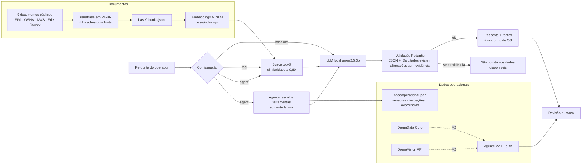
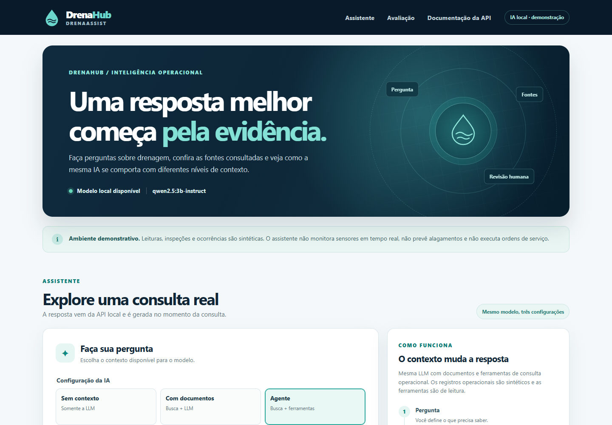

# DrenaAssist — a IA generativa da DrenaHub

**FIAP Global Solution 2026.2 · CitizenTech · Generative AI for Engineering · Treinamento de uma LLM local**

O DrenaAssist é o assistente que responde, em linguagem simples, **"o que eu faço com esse ralo?"**. Ele roda 100% local, consulta procedimentos técnicos de drenagem e os registros de sensores, inspeções e ocorrências da DrenaHub, cita de onde tirou cada informação e **recusa** quando não tem evidência ("Não consta nos dados disponíveis."). Nenhuma decisão é automática: ordens de serviço saem como rascunho para uma pessoa aprovar.

| Link | |
|---|---|
| Repositório | https://github.com/Torugo0/drenahub-genai |
| Vídeo de demonstração | **(inserir link do vídeo aqui)** |

## Integrantes

| Nome completo | RM |
|---|---|
| Gabriel Machado Carrara Pimentel | RM99880 |
| Lourenzo Ramos | RM99951 |
| Vítor Hugo Rodrigues | RM97758 |

## 1. Ficha técnica

| Campo | Descrição |
|---|---|
| Produto | **DrenaAssist**, componente *Inteligência* da startup DrenaHub |
| Cidadão e território | Síndicos, zeladores e equipes de manutenção de condomínios, garagens e áreas logísticas de São Paulo; indiretamente, moradores e motoristas afetados por alagamentos |
| Problema, em uma frase | Ralos e caixas de captação entopem entre uma inspeção e outra, e quem cuida deles não tem tempo nem formação para cruzar manuais técnicos com leituras de sensores, fotos e ocorrências antes da chuva |
| Eixo do desafio | **Segurança** (alagamentos e enchentes urbanas) |
| Tarefa da IA | Responder perguntas sobre inspeção e manutenção de drenagem em **JSON válido**, com **citação da fonte**, recusa explícita quando não há evidência e, no modo agente, **rascunho de ordem de serviço** para revisão humana |
| Proposta de valor | Transformar documentação técnica e dados operacionais dispersos em uma resposta curta, rastreável e auditável |
| Modelos de IA | `qwen2.5:3b-instruct` via Ollama (geração, local); `paraphrase-multilingual-MiniLM-L12-v2` (embeddings, local); `Qwen2.5-1.5B-Instruct` + **adaptador QLoRA treinado por nós** |
| Fontes de dados | 9 documentos públicos (EPA, OSHA, NOAA/NWS, Erie County) em 41 trechos; registros operacionais sintéticos; exportação Ouro da DrenaData (chuva real Open-Meteo); eventos da API DrenaVision |
| Indicadores de impacto | % de respostas corretas, % de respostas com afirmação sem evidência, recusas corretas, recall@k da busca; no produto: tempo até a ordem de serviço e ralos inspecionados antes da chuva |
| ODS | **11** (cidades sustentáveis: drenagem que funciona reduz alagamentos), **13** (adaptação a chuvas extremas), **6** (água e saneamento) e **3** (menos exposição a água contaminada e vetores) |

### Onde o DrenaAssist entra na DrenaHub

| Componente | Repositório | O que entrega ao DrenaAssist |
|---|---|---|
| DrenaData (Big Data) | `drenahub-bigdata` | Exportação Ouro com níveis dos pontos e chuva horária real (Open-Meteo) |
| DrenaVision (Visão computacional) | `drenahub-drenavision` | Eventos de detecção de resíduos, água e animais em fotos/vídeos, sempre pendentes de revisão |
| DrenaBot (Maker Lab) | protótipo físico | Sensores de nível/contato com água que alimentam a DrenaData |
| Site e Central (Pitch) | `drenahub-web` | Onde o operador vê as ocorrências; o DrenaAssist expõe a API que a Central consome |
| **DrenaAssist (este)** | `drenahub-genai` | Explica, justifica com fontes e propõe a próxima ação |

## 2. Pipeline de IA e dos documentos



1. **Base**: cada trecho tem `chunk_id`, documento, URL, licença e data de acesso. Só documentos entram no índice; registros operacionais nunca são "lembrados" pelo modelo, são consultados por ferramenta.
2. **Busca**: embeddings normalizados, produto interno (= cosseno), top-3, corte em 0,60.
3. **Geração**: o prompt obriga JSON com `answer`, `refused`, `source_ids`, `reason`, `suggested_actions`. O código valida o JSON, descarta IDs que não estavam no contexto e recusa respostas operacionais sem registro que as sustente.
4. **Agente**: a LLM planeja chamadas a 7 ferramentas de leitura (`get_sensor_readings`, `get_recent_events`, `get_visual_inspections`, `get_maintenance_history`, `get_event`, `get_points`, `get_maintenance_queue`). Ferramenta fora da lista é bloqueada; se o plano vier vazio, um fallback determinístico busca a evidência mínima. Todo uso fica em `avaliacao/tool_calls.jsonl`.

## 3. Base de conhecimento

Detalhes e justificativa de uso em [`base/FONTES.md`](base/FONTES.md). Os textos são paráfrases originais em português; os PDFs originais não são redistribuídos.

| Documento | Fonte | Formato original | Licença / condição de uso | Trechos |
|---|---|---|---|---:|
| EPA-OM | EPA – Stormwater maintenance | HTML | Publicação federal EUA; paráfrase com atribuição | 4 |
| EPA-CB | EPA 832-F-99-011 (caixas de captação) | TXT | Publicação federal EUA; paráfrase com atribuição | 6 |
| EPA-PM | EPA 832-F-99-004 (manutenção preventiva) | TXT | Publicação federal EUA; paráfrase com atribuição | 5 |
| EPA-SWPPP | EPA – Guia SWPPP 2021 | TXT | Publicação federal EUA; paráfrase com atribuição | 6 |
| EPA-LIFT | EPA – Estação elevatória (bombas) | TXT | Publicação federal EUA; paráfrase com atribuição | 5 |
| OSHA-FLOOD | OSHA – Resposta a inundações | HTML | Orientação de agência federal; paráfrase com atribuição | 5 |
| NWS-BEFORE | NOAA/NWS – Antes da enchente | HTML | Domínio público | 3 |
| NWS-DURING | NOAA/NWS – Durante a enchente | HTML | Domínio público | 3 |
| EPA-CHECK | Erie County – limpeza de caixas e galerias (PDF hospedado pela EPA) | PDF | Titularidade não confirmada; apenas fatos resumidos | 4 |
| **Total** | | | | **41** |

## 4. Tarefa e casos de teste

[`avaliacao/casos.json`](avaliacao/casos.json): **40 perguntas com gabarito** escrito antes de rodar o modelo, divididas em **20 de desenvolvimento** (usadas só para escolher o limiar) e **20 finais**. Cada caso traz resposta esperada, fatos obrigatórios, trechos-ouro, fontes admitidas e se deve recusar.

| Tipo | Casos |
|---|---:|
| Documental (procedimentos) | 18 |
| Operacional (sensor, inspeção, ocorrência, manutenção, pré-chamado, relatório) | 14 |
| Múltiplas fontes | 2 |
| **"Não consta"** (sem registro / sem resposta documental / indução a alucinar) | **6** |

## 5. Busca: recall@1, recall@3 e limiar

`recall@k = |trechos-ouro ∩ top-k| / |trechos-ouro|`. O limiar foi escolhido **só no desenvolvimento**, maximizando `(recall@3 + taxa de rejeição de perguntas sem suporte) / 2`, desempate pelo maior limiar ([`limiar.json`](avaliacao/resultados/limiar.json)).

| Limiar (dev) | recall@1 | recall@3 | Rejeita "sem suporte" | Escore |
|---:|---:|---:|---:|---:|
| 0,40 ou menos | 0,80 | 0,95 | 0% | 0,475 |
| 0,45 a **0,60** | 0,80 | 0,95 | 100% | **0,975** |
| 0,65 | 0,80 | 0,90 | 100% | 0,950 |
| 0,70 | 0,50 | 0,50 | 100% | 0,750 |

**Por que 0,60:** é o ponto mais alto antes de começar a perder trechos relevantes. Abaixo de ~0,45 a busca devolve contexto para perguntas que não têm resposta na base, e o modelo tende a "inventar a partir de algo".

| Conjunto | Perguntas com gabarito | recall@1 | recall@3 | Rejeição sem suporte |
|---|---:|---:|---:|---:|
| Desenvolvimento | 10 | 0,80 | 0,95 | 1/1 |
| **Final** | 10 | **0,55** | **0,60** | 2/2 |

A queda no final é real e não foi "consertada" mexendo no limiar com os casos de teste: em D16, D18 e D19 os trechos OSHA/NWS ficaram abaixo de 0,60 (ver erro 3 e ranking em [`recuperacao_individual.csv`](avaliacao/resultados/recuperacao_individual.csv)).

## 6. Geração fundamentada: JSON, citação e recusa

Resposta real gravada pela API (`avaliacao/resultados/demo_api/`), modo RAG:

```json
{
  "answer": "No registro de inspeção de drenagem, deve constar data e hora, responsáveis, tempo meteorológico, condições dos pontos de descarga, indícios de poluentes...",
  "supported": true,
  "refused": false,
  "sources": [{"source_id": "EPA-SWPPP-04", "url": "https://nepis.epa.gov/Exe/ZyPURL.cgi?Dockey=P1011EAT.TXT"}],
  "suggested_actions": ["Registrar todos os pontos de descarga e observar indícios de poluição."],
  "draft_work_order": null
}
```

Recusa real, quando a pergunta exige um dado que o modo não tem:

```json
{"question": "Qual foi a última leitura do sensor do RALO-01?", "answer": "Não consta nos dados disponíveis.",
 "supported": false, "refused": true, "sources": [], "reason": "Os documentos técnicos não contêm registros operacionais desta instalação."}
```

Nas 120 respostas avaliadas: **JSON válido 100%**, **recusas corretas 6/6 em todos os modos**, citações aceitas pelo gabarito 87,5% (RAG e agente).

## 7. Placar das três configurações

Mesma LLM (`qwen2.5:3b-instruct`, temperatura 0, seed 42), mesmas 40 perguntas, **120 respostas reais** ([`respostas_brutas.jsonl`](avaliacao/resultados/respostas_brutas.jsonl)). O placar é calculado por regras fixas do gabarito, **sem usar LLM como juiz** ([`metrics.py`](avaliacao/metrics.py)).

| Configuração | O que recebe | Corretas | Corretas (só teste final) | Citações válidas | Ferramentas certas | Latência média |
|---|---|---:|---:|---:|---:|---:|
| **A. Sem contexto** | só a pergunta | 17,5% | 4/20 | 52,5% | — | 1,18 s |
| **B. RAG simples** | pergunta + 3 trechos | 40,0% | 7/20 | 87,5% | — | 1,35 s |
| **C. RAG + agente** | + ferramentas sobre registros | **57,5%** | **10/20** | 87,5% | 90% | 1,69 s |

**Alucinação, medida por revisão humana** das respostas substantivas contra a evidência ([`AUDITORIA_SEMANTICA.md`](avaliacao/AUDITORIA_SEMANTICA.md), [documental](avaliacao/AUDITORIA_DOCUMENTAL_DETALHADA.md), [operacional](avaliacao/AUDITORIA_OPERACIONAL_DETALHADA.md)):

| | Sem contexto | RAG | RAG + agente |
|---|---:|---:|---:|
| Respostas com ao menos uma afirmação sem evidência ou contradita | **15/19 (79%)** | **1/16 (6%)** | **4/30 (13%)** |

**Interpretação**

- **O contexto é o que derruba a alucinação.** Sem contexto, o modelo responde com segurança e quase sempre inventa detalhes (15 de 19 respostas). Com RAG, isso cai para 1 de 16.
- **O RAG acerta mais (+22,5 p.p.), mas recusa demais.** Ele recusou 18 das 34 perguntas que tinham resposta: 14 eram operacionais (o RAG não tem acesso aos registros, então recusar é o comportamento correto) e 4 documentais por erro de classificação (erro 1).
- **O agente é a especialização que vale a pena (+17,5 p.p. sobre o RAG).** Nas perguntas operacionais ele passou de 1/15 para 8/15 porque consulta o registro em vez de supor. O custo é ~0,3 s a mais e mais texto gerado, o que abre espaço para erros de síntese (4/30, inclusive uma contradição que o placar automático não pegou, erro 2).
- **Ninguém acertou as 2 perguntas de múltiplas fontes.** É o próximo limite do sistema.
- O indicador automático "afirmação sem suporte" (47,5% / 12,5% / 12,5%) penaliza o baseline por não citar fonte; por isso a taxa de alucinação acima vem da revisão humana.

## 8. Especialização: agente vs. RAG simples, e o treino LoRA

A rubrica aceita **LoRA ou agente**. Fizemos os dois:

- **Agente (configuração C)** é a especialização usada no produto e comparada ao RAG simples no placar acima.
- **LoRA (treino real de pesos)**: ajustamos `Qwen/Qwen2.5-1.5B-Instruct` (Apache-2.0, revisão fixa) por **QLoRA NF4** (r=8, alpha=16, q/k/v/o) em uma RTX 4060 de 8 GB: 84 exemplos de treino e 18 de validação, 2 épocas, 42 passos, 97 s, perda de validação **0,436**. O adaptador de 8,7 MB está em [`lora/adapter/`](lora/adapter/). Tudo em [`lora/README.md`](lora/README.md).

Resultado do LoRA no conjunto final congelado (24 casos, mesmo checkpoint com e sem adaptador):

| Métrica | Base 1.5B | Base + LoRA |
|---|---:|---:|
| JSON válido | 0/24 | **24/24** |
| Esquema completo | 0/24 | **22/24** |
| Recusa, citação, origem e revisão todas corretas | 0/24 | **14/24** |
| Afirmação sem evidência ou contradita (revisão humana) | — | 7/24 |
| Perguntas adversariais fora do padrão de treino | 0/6 | 1/6 |

**Leitura honesta:** o treino ensinou o **formato e a política** (JSON, citar, marcar revisão humana) quase perfeitamente, mas **não ensinou a não inventar**: em 4 casos o modelo criou uma "última medição em 2023" quando a fonte estava fora do ar. Com 84 exemplos de 6 templates, o LoRA decora a forma, não o raciocínio. Por isso o produto usa **RAG + agente** com o modelo 3B e validação no código; o LoRA fica como experimento documentado, e os 5 erros dele estão em [`lora/ERROS_PILOTO1.md`](lora/ERROS_PILOTO1.md).

## 9. Cinco erros reais e correções

Transcritos das respostas brutas em [`avaliacao/erros.md`](avaliacao/erros.md), com linha, gabarito e evidência.

| # | Caso / modo | O que aconteceu | Causa | Correção proposta |
|---|---|---|---|---|
| 1 | D01 / RAG | Recusou "o que deve constar em um plano de O&M" mesmo com o trecho certo em 1º lugar (0,80) | Regra de intenção tratou "manutenção da" como pergunta operacional | Só bloquear quando houver ID de ponto/unidade ou pedido explícito de registro |
| 2 | O10 / agente | Citou OC-001 "aguardando manutenção" e na mesma resposta disse que não havia nenhuma | Síntese livre gerou conclusão contraditória; o placar só checa fatos positivos | Validar status citados contra a ferramenta e reprovar negações que contradizem a evidência |
| 3 | D10 / RAG | Pergunta com dois tópicos (controles pluviais **e** bomba) respondida pela metade | Uma única busca vetorial trouxe só trechos industriais; o da bomba (`NWS-BEFORE-03`) não passou do limiar. recall@3 = 0,5 | Decompor a pergunta em até duas buscas e exigir cobertura de cada tópico antes de gerar |
| 4 | O01 / agente | Explicou a prioridade alta sem o valor de 11,2 cm que a justifica | A síntese resumiu como "acima do limite" e perdeu a medição | Montar no código a frase "medido X cm, limite Y cm" a partir do registro; a LLM só explica |
| 5 | O15 / agente | Descreveu a ocorrência OC-004 em vez da intervenção MAN-002 | O planejador chamou só `get_event` e não `get_maintenance_history` | Para "intervenção concluída", tornar `get_maintenance_history` obrigatório e conferir o `event_id` |

## 10. Segurança, LGPD e IA responsável

- **Local por padrão**: LLM e embeddings rodam na máquina; nenhuma pergunta vai para provedor externo.
- **Sem dados pessoais**: registros operacionais são sintéticos; a DrenaData já entrega o responsável como hash SHA-256. Credenciais só por variável de ambiente (`.env.example`).
- **Somente leitura**: o agente não altera ocorrências nem aciona bombas; ferramentas fora da lista são bloqueadas e toda chamada é registrada.
- **Explicável**: toda resposta traz `sources`, `reason` e o percurso de ferramentas (visível na interface).
- **Pessoa no circuito**: ordem de serviço é sempre rascunho pendente de aprovação; detecção da DrenaVision é tratada como "pendente de revisão", nunca como obstrução confirmada.
- **Limites declarados**: a base é pequena e majoritariamente norte-americana; não substitui norma local nem engenheiro. O sistema não prevê alagamentos.

## 11. Como reproduzir (Windows PowerShell)

Pré-requisitos: Python 3.10 e [Ollama](https://ollama.com/download/windows).

```powershell
py -3.10 -m venv .venv
.\.venv\Scripts\Activate.ps1
python -m pip install -r requirements.txt
ollama pull qwen2.5:3b-instruct
```

**Abrir o produto** (API + interface):

```powershell
python -m uvicorn app.api:app --host 127.0.0.1 --port 8001
```

- http://127.0.0.1:8001/ — interface: escolha *Sem contexto*, *Com documentos* ou *Agente* e pergunte. A aba **Avaliação** mostra o placar.
- http://127.0.0.1:8001/docs — API (`POST /assistant/ask`, `GET /evaluation/results`, `GET /health`).
- http://127.0.0.1:8001/v2/console — console conectado à DrenaData e à DrenaVision (opcional; defina `DRENA_V2_DATA_EXPORT_DIR` com a pasta `mvp/dados` da DrenaData e `DRENA_V2_VISION_URL` com a API da DrenaVision).



**Refazer a avaliação completa** (40 perguntas × 3 configurações; alguns minutos com GPU, sobrescreve `avaliacao/resultados/`):

```powershell
python -m avaliacao.run --phase all --fresh
```

**Testes e notebooks:**

```powershell
python -m pytest -q                         # 98 testes
python -m avaliacao.criar_notebook --execute  # recria notebooks/experimentos.ipynb
python lora/criar_notebook.py                 # recria notebooks/lora_qwen.ipynb
```

O treino LoRA exige CUDA no Linux/WSL2; passo a passo em [`lora/README.md`](lora/README.md).

## 12. O que tem em cada pasta

| Pasta | Conteúdo |
|---|---|
| `app/` | O produto: API FastAPI, busca (RAG), agente com ferramentas, cliente Ollama e a interface web em `app/static/` |
| `base/` | Base de conhecimento: 41 trechos com fonte (`chunks.jsonl`), `FONTES.md` e os registros operacionais sintéticos |
| `avaliacao/` | Casos com gabarito, executor, métricas, placar, os 5 erros, auditorias humanas e todas as respostas brutas em `resultados/` |
| `notebooks/` | `experimentos.ipynb` (RAG × agente, com saídas) e `lora_qwen.ipynb` (resultado do treino LoRA, com saídas) |
| `lora/` | Treino QLoRA: dataset congelado, script de treino e avaliação, adaptador treinado, resultados, e o agente V2 conectado à DrenaData/DrenaVision |
| `tests/` | 98 testes automatizados |

## 13. Conclusão técnica

Uma LLM pequena (3B) rodando em um PC comum **erra muito e inventa muito quando responde sozinha** (17,5% de acerto, 79% das respostas com invenção). Dar a ela os **documentos certos** (RAG) e a capacidade de **consultar os registros** (agente) eleva o acerto para 57,5% e derruba a invenção para 6–13%, sem nenhum dado sair da máquina. Treinar pesos (LoRA) resolveu o formato da resposta, mas não a veracidade; para este problema, **contexto verificável vale mais que fine-tuning com poucos exemplos**. Os próximos passos são corrigir os 5 erros, ampliar a base com normas brasileiras (ABNT/prefeitura) e ligar a Central DrenaHub ao endpoint `/assistant/ask`.

- Repositório: https://github.com/Torugo0/drenahub-genai
- Vídeo: **(inserir link do vídeo aqui)**
